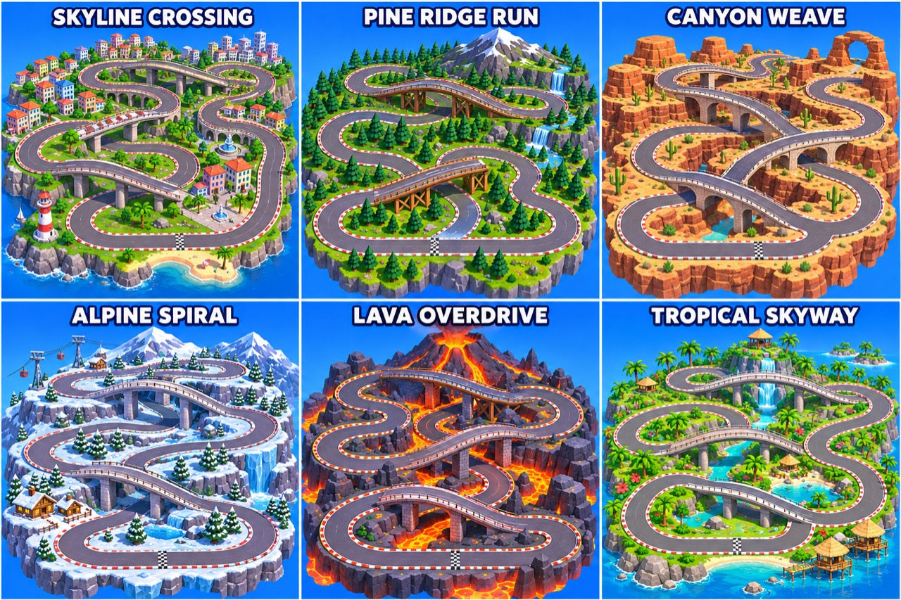

# LetsGo master plan notes

Recorded 23 November 2026. These notes bring together the owner's decisions, ideas and preferences from the kart and racing conversation and the existing game records. Use them when reviewing the whole game with Claude Code Ultra and Codex. The feature cards and engineering records linked here provide the details and approval history. [Ideas index](IDEAS-INDEX.md) · [Project handoff](HANDOFF.md)

## A. Game direction and how to use these notes

1. **Owner direction.** Build LetsGo around an athletic, expressive avatar and a connected island world. The player can explore, drive, swim, play sports and other minigames, win gear, and return to a home island they can make their own.
2. **Owner direction.** Lay solid foundations before expanding the game. For the avatar, settle the body and usable range of movement before tuning the full motion set. For karts, settle the actual chassis, wheel positions, seat and modular parts before another broad handling pass. Keep the liked 3D World 3 LetsGo race as a feel reference, including the NPC opponents and the time-trial ghost. Use the approved 3D World 4 checkpoints as playable references. [Avatar direction](AVATAR-DIRECTION.md) · [Racing rebuild](../racing-core/PLAN.md) · [Driving Checkpoint 2](https://isaiasurrutia96.github.io/3D-World-4/checkpoints/driving-2/?drive=1&handling=fast)
3. **Owner workflow.** Research and compare credible methods before each task. For a new problem, use proven ways to form a hypothesis, prototype, measure and revise it. Write and review solid code line by line, test the real entry point, and seek the owner's feedback on how it looks and feels. The owner wants a final, deeper line-by-line review near the end of the game. [How to work with the owner](HOW-TO-WORK-WITH-ME.md) · [Responsibilities and review](COLLABORATION.md)
4. **Planning status.** Confirmed choices, ideas, deferred features and rejected directions keep their recorded status. The whole-game roadmap and any trade-offs will be decided after the owner and both assistants review the project reports. These notes cover the available conversation and repo records. Bring in separate conversations and reports as they become available. [Ideas index](IDEAS-INDEX.md)

## B. World visual direction and the six islands

1. **Owner favorite.** Skyline Crossing Island is the leading visual reference for the whole world. The owner especially likes the city and wants to explore using its design language across LetsGo. Its stacked city blocks, mixed-height colorful buildings, waterfront, plazas, lighthouse, viaducts, gardens and multiple road levels give us a way to make a place that feels worth exploring on foot and driving through.
2. **Owner likes the whole board.** Keep all six themes and use the visual details in the table below when planning the world. Their roles, final shapes and connections are decisions for the world plan.
3. **Design opportunity.** Carry Skyline's mix of destinations, terrain, vertical layers and bridges across the world. Let each island express it through its own environment. The board is a visual reference. The approved racing geometry, including the height differences and overpasses, has its own engineering record. [Six-island reference board](world/skyline-crossing-and-island-concepts.jpg) · [Track geometry and approvals](../racing-core/PLAN.md)

| Island on the board | Elements to retain as visual ideas |
| --- | --- |
| **Skyline Crossing** | Colorful coastal hill city, stacked neighborhoods and taller city blocks, arched stone roads, layered crossings, plazas and fountains, lighthouse and sandy cove. |
| **Pine Ridge Run** | Dense pine forest, rocky cliffs and snowy mountain backdrop, timber trestles above ravines, waterfalls and streams beneath the roads. |
| **Canyon Weave** | Warm sandstone mesas, layered canyons, cacti, natural arches, water deep in the ravines and bridges between ledges. |
| **Alpine Spiral** | Snowy peak, switchbacks at several heights, stone viaducts, icy waterfalls, evergreen trees, chalets and cable cars. |
| **Lava Overdrive** | Erupting volcano, black rock towers, glowing lava flows, stone and timber crossings and a clear contrast between safe roads and lava below. |
| **Tropical Skyway** | Palms, bright flowers, stepped waterfalls, turquoise pools, stone bridges, beaches, overwater huts and small offshore islands. |

4. **Garden and winter floating islands (proposed, 25 November 2026).** The owner asked for a hanging garden island and an alpine winter island built from the approved block cards. In both studies, a kart road follows the side of the cliffs at several elevations, with separate paths into small carnival and minigame areas. The garden concept combines a conservatory, waterfalls, skee-ball, mini golf and a basketball court. The winter concept pairs lit switchbacks and stone overpasses with a village fair, skating rink and ski slope. The images are for visual review. The island placement, circuit geometry and choice of attractions are open. [Garden island concept](world/floating-garden-island-concept.png) · [Winter island concept](world/floating-winter-island-concept.png)

5. **All-activities floating island (proposed, 25 November 2026).** The owner asked for one voxel island with waterfalls, swimmable water and destinations for the existing 20 minigames. The concept has a small S-kart circuit at ground level across the garden terraces, with a staging area for races and ghost time trials. An independent wider F1 road travels around the island in open sky, enters a tunnel in a block-built mountain spur and comes back out to the sky circuit. Its foreground span passes outside the waterfall outlets. The lazy river has its own small swim-through tunnel, with a deep basin and diving board nearby. [All-activities island concept](world/floating-island-all-activities-concept.png)

   | Area | Activities shown in the concept |
   | --- | --- |
   | Garden terraces and putting grounds | Full golf, mini golf, frisbee golf. |
   | Carnival boardwalk | Bowling, skee-ball, billiards and darts in open-front pavilions. |
   | Sports terraces | Basketball shooting, soccer penalties, baseball batting, football throwing, archery and paintball. |
   | Adventure terrace | Obstacle course, long jump and high jump, and skate racing. |
   | Snow ridge | Downhill skiing and a separate winding ice-skating race. |
   | Roads and waterfront | Kart racing and time trials, the requested F1 sky route, plus swimming and recreational high diving. |

   The concept records the owner's requested arrangement for review. Circuit gradients and tunnel clearances, activity sizes and routes between venues are open design questions. [Approved block cards](WORLD-RULES.md#e-blocks-26-approved-19-nov-2026-one-card-each) · [Minigame cards](MINIGAMES.md)

6. **Connected floating-island study (proposed, 26 November 2026).** Both views come from one voxel scene. The F1 circuit follows the Nürburgring Grand Prix centerline at island scale, with a 2.16 km sky lap and a 66 m mountain tunnel. The separate S-kart lap is 293 m. An 18 m swim tunnel connects two lagoons at one water level. The shared plan shows each route and the walking connections between activity terraces. [Front view](world/connected-island/front-view.png) · [Back view](world/connected-island/back-view.png) · [Shared plan and checks](world/connected-island/README.md)

7. **Island layout selected by the owner (25 November 2026).** The selected illustration sets the overall composition. The compact floating island has the snow ridge and village at the back, golf to the west, sports and adventure terraces to the east, a central conservatory and carnival, and lagoons at the front beneath the waterfalls. The revised views use the same checked plan. Its perimeter F1 circuit is a closed 1.40 km lap through the northwest ridge, the S-kart circuit is a separate 564 m loop, and a 29 m swim passage joins the two lagoons. The route measurements are for layout review. [Selected illustration](world/floating-island-all-activities-concept.png) · [Paired views and measured plan](world/island-layout/README.md)

## C. Stock karts and the latest wheel measurements

1. **Use these as the current wheel baselines.** Wheelbase is front axle to rear axle. Front and rear track are left tire center to right tire center on their respective axles. All numbers below are in millimeters. The detailed drawings, body and cockpit measurements live in the kart design brief. Earlier size boards, Test Lab prototypes, tier pictures and real vehicle dimensions are background references. Use the latest measurements below when planning or fitting a stock kart. [Stock dimensions and cockpit drawings](KART-DESIGN.md#stock-chassis-dimensions)

   | Class | Wheelbase | Front track | Rear track | Front / rear tire diameter × width |
   | --- | ---: | ---: | ---: | --- |
   | **S Kart / S Class** | **1,490** | **1,120** | **1,230** | 400 × 155 / 420 × 200 |
   | **GT GoKart / GT Class** | **1,980** | **1,340** | **1,350** | 535 × 240 / 560 × 245 |
   | **F1 GoKart / F1 Class** | **2,650** | **1,200** | **1,150** | 565 × 225 / 570 × 300 |

2. **Selected stock looks.** S Kart option 01 is the red Wraparound Bumper, style 11. GT option 05 is the open-cockpit miniature GT3 R inspired by the 2026 Porsche 911 GT3 R Evo, with arches over the wheels and the rims visible. F1 option 01 is Classic Formula, a miniature 2026 Formula 1 car with open wheels, a long and low nose, wider rear tires and clean panels around the front wheels and side pods. Start with one stock model per class and keep the three visually related. Use real adult karts, the race Porsche and the 2026 Mercedes-AMG Formula 1 car as references in the order S, GT and F1. [Model choices and parts](karts/PARTS-KIT.md#h-models-per-class) · [Same-scale comparisons](KART-DESIGN.md#stock-chassis-dimensions)
3. **Fit and model first.** Put the actual seated avatar on the same scale as the stock chassis. Check head and shoulder space, hand reach, pedal reach and travel, steering sweep and room at the fenders and mounts. The current sizing drawings use a 1,894 mm avatar pose based on the measured 1,865 mm reference. The separate 6 ft 4 in avatar study is still a distinct reference in the avatar handoff. If the game rig changes the fit, bring the trade-off to the owner before changing the chosen wheel layout. [Fit dimensions](KART-DESIGN.md#a-stock-cockpit-measurements) · [Avatar handoff](HANDOFF.md)
4. **Reference art the owner wanted.** Number variant sheets so each option is easy to name. Compare karts and avatars at the same scale and ground line. Show front, side and angled views, with top dimension drawings where useful. Favor the consistent slate-blue presentation and original bodies, with clear separate parts and clean, plausible aero surfaces. Earlier front and side size boards remain visual history. [Kart appearance and variations](KARTS.md#b-looks-approved-pictures-in-docskarts) · [Current parts sheets](karts/PARTS-KIT.md)

## D. Driving feel, tuning and testing

1. **S Kart.** The closest to the original LetsGo arcade handling. It should react promptly, turn tightly and recover easily. Give it enough weight to feel the braking and changes of direction. The slightly wider stock stance gives the avatar and tires room without sacrificing the class's compact wheelbase.
2. **GT.** Between the 3D World 3 arcade feel and the newer realistic F1 feel. It should turn in quickly, feel planted when braking and hold a clean arc at the right speed. The owner's specific feedback was that earlier GT3 builds felt too heavy and ran wide while holding a turn. GT3 V3 is a comparison preset, with that feedback still useful for the later stock-kart test. [GT3 V3 notes](karts/GT3-DRIVING-REFERENCE.md#g-gt3-v3-comparison)
3. **F1.** The fastest class, with a smooth, grippy arc at speed and quick response to a small correction. Keep the early F1 feel and steering before the user sharpened it as a reference. The later 2026 F1 preset and research also offer useful comparisons for braking, acceleration, grip and speed sensation. Holding a turn should settle into a predictable arc at the right speed. A faster entry should challenge grip in a way the player can feel and correct. [F1 driving research and presets](karts/F1-DRIVING-REFERENCE.md)
4. **All inputs.** Support keyboard and touch steering buttons, controller sticks and a phone joystick. Button taps should give small corrections, held buttons should build into a stable turn, and release and left-right transitions should feel clean. Partial stick input should give proportional steering with a quiet center. The same vehicle dynamics should govern both input styles.
5. **Geometry and real data.** Use the same stock dimensions and installed part data for the model and simulation. Wheelbase and tire positions affect turning geometry, tire radius affects wheel rotation and gearing, and physical properties such as mass and weight distribution should shape braking and direction changes. Use racing measurements as reference targets sized for our karts and tracks. A later wheel-spacing or part change should use the same driving code, followed by a check of fit and feel. [Physics intentions](KART-DESIGN.md#connect-the-model-to-the-feel)
6. **Standalone Driving Test.** Put driving tests in the standalone picker, including the parked-kart collision course and the compact neighborhood-roads practice layout. The neighborhood request was for roads only, so the owner can judge ordinary turns and driving. Check that impacts are readable, that the kart responds to other karts, and that recovery makes sense. The Test Lab's Karts page is for inspecting models and parts.
7. **References to keep.** The original LetsGo NPC races, best-lap ghost and the approved Fast handling benchmark matter when judging new work. Preserve the existing driving checkpoints. Compare stock builds on the same tight turn, long hold and left-right transition, on buttons and sticks. Owner test drives determine whether the measured behavior feels right. [Tracks and tests](../racing-core/PLAN.md) · [Driving benchmark](https://isaiasurrutia96.github.io/3D-World-4/checkpoints/driving-2/?drive=1&handling=fast)

## E. Kart parts, upgrades and racing items

1. **Part-by-part models.** Keep real attachment points, a shared class platform, and visible parts that are independently shaped. Separate the nose or front wing, bumpers, rear wing or spoiler, diffuser, hood or engine cover, side panels or pods, fenders, mud flaps, rims, tires, seat, steering wheel, exhaust and lights. Shared slots keep their fit within a class. Model-specific body kits can have their own fitted parts. Leave enough clearance for off-road tires and a raised stance on every class. [Approved parts and model rules](karts/PARTS-KIT.md)
2. **Parts change the driving.** The owner wants a noticeable difference from genuine performance parts. Engine and turbo changes can affect speed, acceleration or boost. Tires affect grip and rolling size. Functional airflow through a bumper, hood or fender, and aero parts like wings and diffusers, can change how the kart behaves at speed. Suspension and chassis weight upgrades can change handling. Off-road fitments help on grass and dirt. Tune the magnitude and trade-offs after the stock karts can be driven; detailed stats, pricing, rarity and unlocks remain open. [Kart upgrade rules](KARTS.md#d-parts-that-change-driving) · [Parts catalog](karts/PARTS-KIT.md)
3. **Personalization and garage.** Own and save karts, pick paint and finishes, skins, stickers, rims, lighting, boost effects, smoke, sparks and horn sounds. The approved customization idea includes shops, prizes, home garages and testing a build. Build the stock models first and defer the player-facing modification system until the foundation is ready. [Kart building feature card](FEATURES.md#b-money-and-items)
4. **Racing items.** The owner wants mystery boxes and rejected the banana. The owner wants to reserve the cannons for later. The kit records ideas such as hidden mounts and an oil dropper. The final box contents, rules for weapons, balance, and starting nitro count are decisions for the racing plan. Use this later direction when reviewing the earlier minigame card. [Kart racing card](MINIGAMES.md#1-kart-racing-approved-19-nov) · [Earlier weapon kit](karts/PARTS-KIT.md)

## F. Connected world, progression and everyday play

1. **World structure.** One connected world of themed islands. Walk, drive or swim between places using bridges, roads and rivers. The watch can open a plain door with the destination visible through it. Home islands are a separate space reached through the watch or menu. The world rules establish fixed public terrain, the shared voxel grid, blocks, material behavior and the home building exception. [Connected world and watch](FEATURES.md#a-travel-and-home) · [World rules](WORLD-RULES.md)
2. **Home and exploration.** A home island is somewhere to keep items, build, place kits or a custom track, invite friends and show off what the player has won. Free-roam karts can be parked or recalled with the watch. Swimming, diving, lazy rivers, waterfalls, underwater secrets, and diving boards for fun are recorded exploration ideas. Skateboarding is also a travel and race activity; bikes and scooters were set aside for now. [Feature cards](FEATURES.md) · [World rules](WORLD-RULES.md)
3. **Progression and items.** Keep coins, levels and unlocks, prizes, shops, carrying and pulling out items, the recorded rules for lost or stolen loot, outfits and kart customization. The cards define where each feature works, what persists and its edge cases. Prices, limits and many unlock timings are still open. [Money, items and appearance cards](FEATURES.md#b-money-and-items)
4. **Players and NPCs.** Make the world lively with NPCs and fill open minigame slots with them. Save best laps and other records. Single-player foundations come first, with online play later. Friend invites, shared spaces, spectator possibilities and the rules for messing around with players and NPCs are in the feature cards. Use shared ball, hit and grip systems so different activities can use the same mechanics. [People and play feature cards](FEATURES.md) · [Shared systems and world rules](WORLD-RULES.md#c-shared-systems)

## G. Avatar and minigames

1. **Avatar.** Keep the rigid, jointed mannequin look, with rounded edges and athletic, coordinated movement. Show believable weight shifts, balance, hand placement and follow-through. Start with the owner-approved body parts and joint directions in the current handoff. The 6 ft 4 in shape, the three-piece spine study, range-of-motion review and motion experiments have their own approval statuses. The proposed feel wording for throws, swings and pitches is still under review in the handoff. [Avatar direction](AVATAR-DIRECTION.md) · [Avatar handoff](HANDOFF.md#confirmed-by-the-owner) · [Polish decisions](AVATAR-POLISH-LIST.md) · [Movement research](research/inventing-movement/REPORT.md)
2. **Minigames.** The saved set includes kart racing, time trial, mini golf, full golf, bowling, basketball shooting, football throwing, soccer penalties, baseball batting, archery, darts, frisbee golf, skee-ball, billiards, obstacle courses, long jump and high jump, ice skating races, skiing, skate racing and paintball. The cards record rules, controls to validate, prizes and required motions. Diving boards are for fun. [Minigame cards](MINIGAMES.md)
3. **Shared event flow.** Enter through a gate or the watch, gather players and NPCs, count down, play, show results and prizes, save records, and offer to play again or leave. Kart racing and time trial keep their own rules. Time trial uses a see-through replay of the best lap; track hazards, item drops and race balancing are separate decisions. Keep the four established LetsGo circuit references and the owner's favorite banked oval in consideration when placing racing in the world. [Shared minigame template](MINIGAMES.md#a-shared-template-all-minigames--saved-19-nov) · [Banked oval](NEXT.md#owner-favourite-remember) · [Track plan](../racing-core/PLAN.md)

## H. Questions for the master-plan review

1. Decide how Skyline Crossing informs the whole map, whether it becomes the first city or a hub, how the six themes connect, and which places and minigames belong in the first playable world.
2. Reconcile the current game feature cards, verified code and the Claude Code Ultra reports when they are available. Record which systems are ready to use, which need prototype tests, and which have open owner decisions.
3. Agree on the roadmap after that review. Use the latest stock kart wheel dimensions, the approved avatar and driving references, and the standing decision statuses to plan the work. Keep class events, mixed-class racing, exact upgrade stats and unlocks, and final race items open until the owner decides them.
