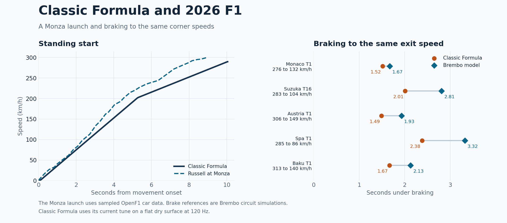

# Classic Formula and 2026 F1 driving reference

Research recorded on 22 November 2026. The selected stock body is **F1 01
Classic Formula**. The playable 4.60 m prototype uses the first F1-inspired
Fast tune, fingerprint `kart-v1-a86c3ae8d1936d52`. Its numerical settings match
the original tune at `4060703`, from before the sharper steering and tire-grip
changes. Use that playable kart as the control for the experiments in section E.
[Stock selection](PARTS-KIT.md#h-models-per-class) ·
[Prototype dimensions and profile](../../racing-core/kart/prototypes.ts) ·
[First F1-inspired Fast tune](https://github.com/isaiasurrutia96/3D-World-4/blob/4060703/racing-core/kart/profiles.ts#L53)

## A. Braking and throttle release

1. Brembo modeled a braking zone at each of these 2026 races. The game tests
   start at the same speed and use full brake on a flat surface to the same
   exit speed. Track conditions and pedal application affect the comparison.

   | Zone | Entry to exit | Brembo time, distance and peak | Classic Formula time, distance and peak | Source |
   | --- | ---: | ---: | ---: | --- |
   | Monaco Turn 1 | 276 to 132 km/h | 1.67 s, 91 m, 4.0 g | 1.52 s, 83 m, 3.85 g | [Brembo](https://www.brembo.com/en/motorsport/formula1/2026/facts-monaco-2026) |
   | Suzuka Turn 16 | 283 to 104 km/h | 2.81 s, 135 m, 3.7 g | 2.01 s, 101 m, 3.94 g | [Brembo](https://www.brembo.com/en/motorsport/formula1/2026/facts-2026-japan) |
   | Austria Turn 1 | 306 to 149 km/h | 1.93 s, 109 m, 3.8 g | 1.49 s, 91 m, 4.00 g | [Brembo](https://www.brembo.com/en/motorsport/formula1/2026/facts-austria-2026) |
   | Spa Turn 1 | 285 to 86 km/h | 3.32 s, 145 m, 3.6 g | 2.38 s, 112 m, 3.96 g | [Brembo](https://www.brembo.com/en/motorsport/formula1/2026/facts-belgium-2026) |
   | Baku Turn 1 | 313 to 140 km/h | 2.13 s, 123 m, 3.9 g | 1.67 s, 101 m, 4.00 g | [Brembo](https://www.brembo.com/en/motorsport/formula1/2026/facts-baku-2026) |

2. The game reached the exit speeds **9–28% sooner**, with peak deceleration in
   broadly the same range. In Gasly's Monza pole lap, an observed braking
   window went from **305 to 92 km/h in 2.72 s over about 123 m**. The game
   covered **121 m in 2.40 s** at those same speeds. Match elapsed time,
   distance, and the shape of the slowdown when tuning brake release.
   [Monza qualifying](https://www.formula1.com/en/results/2026/races/1293/italy/qualifying) ·
   [OpenF1 car data](https://openf1.org/docs/#car-data)
3. Releasing the gas at **250 km/h** in Classic Formula slowed it to
   **225.5 km/h after 0.50 s** and **195.7 km/h after 1.00 s** with zero brake
   input. Deceleration reached **1.86 g at 0.25 s**. The stock lift response
   builds over **0.24 s**, and aerodynamic and rolling resistance are
   represented by the coast term. This is a useful test for a gentler lift
   that still gives the kart weight on corner entry.
   [Stock profile](../../racing-core/kart/profiles.ts#L60) ·
   [Pedal and coast logic](../../racing-core/kart/dynamics.ts#L79)

## B. Launch, rolling acceleration and shift cadence

1. The Monza race column uses Russell's continuous standing-start trace.
   Times are approximate from the last near-stationary sample. The game
   column uses full normal throttle from rest.

   | Speed gate | Russell at Monza | Classic Formula |
   | --- | ---: | ---: |
   | 100 km/h | 2.4 s | 2.65 s |
   | 200 km/h | 4.5 s | 5.22 s |
   | 250 km/h | 6.5 s | 7.88 s |
   | 280 km/h | 7.6 s | 9.51 s |
   | 300 km/h | 9.0 s | Normal cap 289.7 km/h |

2. The **200 to 250 km/h** interval took about **2.04 s** in Russell's trace
   and **2.66 s** in the game. Classic Formula's commanded acceleration
   falls from **10.8 to 5.1 m/s²** between **199.8 and 203.4 km/h**. Test a
   smoother transition through this range. The boost cap is **354.1 km/h**
   and the fastest official speed-trap reading in Monza qualifying was
   **338.1 km/h**. A speed trap measures a fixed point on the track.
   [FIA Monza speed trap](https://api.fia.com/events/fia-formula-one-world-championship/season-2026/italian-grand-prix/qualifying-classification) ·
   [Classic Formula acceleration curve](../../racing-core/kart/profiles.ts#L60)
3. The four pole laps cover a wide range of speed and gear use. Speeds and
   RPM are observed samples within each timed lap.

   | Circuit | Driver and pole time | Sampled speed | Gears | Highest sampled RPM under heavy throttle |
   | --- | --- | ---: | ---: | ---: |
   | Monaco | Kimi Antonelli, 1:12.051 | 44–289 km/h | 1–7 | 12,386 |
   | Suzuka | Kimi Antonelli, 1:28.778 | 74–321 km/h | 1–8 | 11,743 |
   | Silverstone | Kimi Antonelli, 1:28.111 | 87–317 km/h | 2–8 | 12,053 |
   | Monza | Pierre Gasly, 1:21.786 | 71–342 km/h | 1–8 | 12,038 |

   At **95% throttle or more**, the median speeds of the first sample in
   the next gear were approximately **157, 184, 212, 239, 269, and 304 km/h**
   for shifts **2→3 to 7→8**. Use this range for an initial automatic shift
   and engine-sound experiment. Sampling intervals and team gearing affect
   the observed values. [Official pole times](https://www.formula1.com/en/results/2026/awards/pole-positions) ·
   [OpenF1 car data](https://openf1.org/docs/#car-data)

## C. Hardware and regulatory references

1. These figures use the FIA technical rules issued on **19 October 2026**
   and the Mercedes W17 as a published example.

   | Area | 2026 reference and implications |
   | --- | --- |
   | Chassis | FIA maximum wheelbase **3,400 mm** and body-width limit **1,900 mm**, excluding tires and rims. Mercedes lists the W17 at **under 5,505 mm long, 1,900 mm wide, and 970 mm high**. Classic Formula measures **4,600 × 2,020 × 1,475.5 mm**, with **3,040 mm** wheelbase. |
   | Mass and balance | Minimum **726 kg plus nominal tire mass** in qualifying and sprint qualifying, **724 kg plus nominal tire mass** in other sessions. Mercedes lists the W17 at **772 kg**. The qualifying axle minimums imply **44–46% front** and **54–56% rear** for a car at minimum mass. Driver plus driver ballast is at least **82 kg**. |
   | Engine and transmission | **1.6 L 90° turbo V6**, **24 valves**, **8 forward gears**, **1 reverse**. Mercedes lists **15,000 rpm maximum** and sequential hydraulic shifts. FIA fuel-energy flow limit **3,000 MJ/h**. |
   | Tires | **18-inch rims**, slicks **705 × 280 mm front** and **710 × 375 mm rear** (diameter × width). Classic Formula uses **740 × 280 mm front** and **800 × 350 mm rear**. Pirelli supplies five slick compounds **C1–C5**, plus intermediate and wet tires. |
   | Brakes | Carbon discs and rear brake-by-wire on the W17. FIA disc diameter **325–345 mm front**, **260–280 mm rear**, maximum **34 mm thickness**. The five Brembo studies use **99–115 kgf** of peak pedal load. |
   | Suspension | Independent front and rear suspension. The W17 uses carbon wishbones and pushrod-operated springs and dampers. |
   | Aero | The front and rear wings have Corner and Straight positions. Maximum transition is **400 ms** under the FIA rules. |
   | Hybrid | Maximum **350 kW electrical** and **4 MJ** usable charge swing. The normal electrical deployment ceiling is **350 kW at 290 km/h**, **200 kW at 320 km/h**, and **zero at 345 km/h**. Overtake has a separate limit that reaches zero at **355 km/h**. Event restrictions can reduce permitted deployment. |

   [FIA technical regulations, issue 21](https://www.fia.com/system/files/documents/fia_2026_f1_regulations_-_section_c_technical_-_iss_21_-_2026-10-19.pdf) ·
   [Mercedes W17 specifications](https://www.mercedesamgf1.com/f1-w17-2026-technical-specifications) ·
   [Mercedes tire dimensions](https://www.mercedesamgf1.com/news/what-are-the-tyre-options-for-the-2026-italian-gp) ·
   [Pirelli compound range](https://press.pirelli.com/pirelli-reveals-2026-f1-tyres-a-fresh-logo-design-and-new-compounds/)
2. At Monza, the published dry-tire prescription was a minimum **26 psi**
   starting pressure front and rear, expected stabilized running pressure
   **at least 27 psi**, and camber limits of **−3° front** and **−2° rear**.
   Tire pressure and alignment are circuit-specific references for later
   setup work. Steering ratios, damping, tire force curves, and aero maps
   depend on the team's setup.
   [FIA Monza Pirelli prescriptions](https://www.fia.com/system/files/decision-document/2026_italian_grand_prix_-_competition_notes_-_pirelli_preview.pdf)

## D. Test method and data sources

1. The in-game results were run from `f5fffb4` with the F1 prototype geometry
   and `PROTOTYPE_HANDLING.f1`. Use `createKartController` with a flat world
   (`heightAt` always returns zero), default surface multipliers, and no
   contacts. Advance one step at a time at **120 Hz**. Use full throttle for
   the launch, `brakeAmount: 1` for matched-speed braking, and release all
   inputs immediately after the launch passes 250 km/h for the lift test.
2. For a brake entry above the normal cap, set the initial speed and start
   with the **2 s** boost timer active so overspeed recovery cannot be counted
   as service braking at entry. Keep throttle at zero. Interpolate between
   samples bracketing a speed gate for elapsed time and distance. Take peak
   deceleration from `handling.brakingG`. The current game takes **430 m**
   from rest to reach **280 km/h** before any braking.
   [Controller](../../racing-core/kart/index.ts) ·
   [Prototype config](../../racing-core/kart/prototypes.ts)
3. For OpenF1, use `laps` to obtain the recorded lap start and duration, then
   bound `car_data` by those timestamps. The race launch uses the last
   near-stationary sample on lap 1 and interpolated speed crossings. Other
   launch traces contained frozen readings around the higher speed gates,
   so the full comparison uses Russell's continuous trace. Samples typically
   arrive a few times per second. The public brake field gives an on/off
   indication and public launch times are approximate.

   | Event | Session key | Driver number | Lap |
   | --- | ---: | ---: | ---: |
   | Monza race start | 11361 | 63 | 1 |
   | Monza qualifying | 11357 | 10 | 17 |
   | Monaco qualifying | 11295 | 12 | 27 |
   | Suzuka qualifying | 11249 | 12 | 11 |
   | Silverstone qualifying | 11322 | 12 | 18 |

   Gasly's Monza qualifying brake window is at about **8.36–11.08 s** after
   the first sampled point of the lap. Distance is the time integral of
   sampled speed using trapezoids. For the shift reference, take adjacent
   observations in successive gears with no braking, at least 95% throttle,
   and a gap under 0.55 s. Report the median speed in the first observed
   sample in the next gear. [OpenF1 laps](https://openf1.org/docs/#laps) ·
   [OpenF1 car data](https://openf1.org/docs/#car-data)

## E. Proposed tuning order

1. **Corner entry first.** Compare the original tune with a candidate for
   more distinct lift, braking, and turn-in. Use a high-speed lift, hard
   straight-line braking, and a corner with brake release as steering builds.
   Compare entry and minimum speed, distance, elapsed time, peak force, and
   remaining lateral grip. The current tire model budgets longitudinal and
   lateral force together. [Tire force calculation](../../racing-core/kart/dynamics.ts#L91)
2. **Check steering against corner radii.** The dry lateral budgets are
   **1.43 g at 50 km/h**, **2.75 g at 150 km/h**, and **4.65 g at 250 km/h**.
   A **110 m radius** sweep at **250 km/h** requires **4.47 g** of lateral
   acceleration. A **50 m radius** corner at that speed requires **9.84 g**.
   Use the chassis, tire budget, and track together to choose the test speeds
   for a hairpin, a medium bend, and a fast sweeper. [Speed-sensitive steering](../../racing-core/kart/profiles.ts#L187)
3. **Tune midrange pull and shift sound.** Check **100 to 200** and **200 to
   250 km/h** as individual intervals and fit the power curve across the
   transition. Prototype a rev drop and shift cue from the sampled gears.
   Use rolling starts for high-speed comparisons when the goal is to isolate
   braking or steering response.
4. **Give aero parts measurable effects.** Track front-wing effects on
   high-speed turn-in and rear-wing effects on rear stability and drag. At
   equal air density and wing setting, force at **250 km/h** is **6.25×**
   the force at **100 km/h**. Apply parts' load and drag through the same
   speed-dependent grip calculation and compare each change on the same run.
   [NASA lift equation](https://www1.grc.nasa.gov/beginners-guide-to-aeronautics/lift-equation/) ·
   [NASA drag equation](https://www1.grc.nasa.gov/beginners-guide-to-aeronautics/drag-equation/)

The first candidate is a corner-entry A/B test in the standalone Driving
Test, using the current early tune as the control. The owner can judge how
clearly the kart distinguishes lifting, braking, and easing off the brake as
it settles into the turn.
